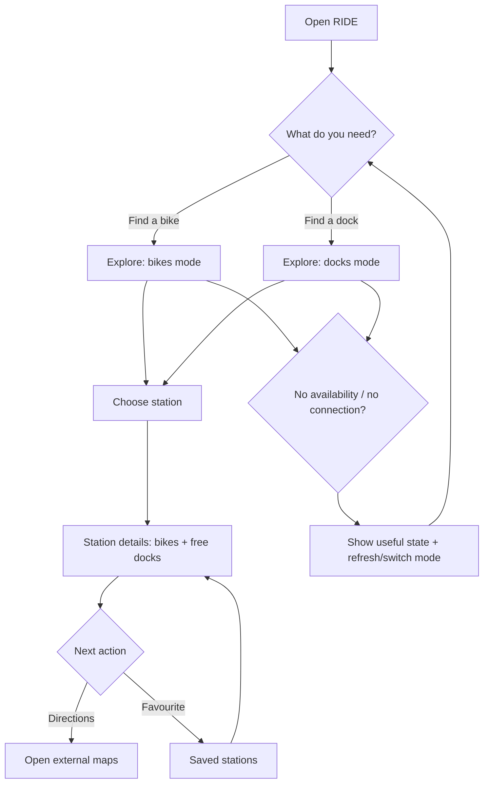

# RIDE — Userflow

Both map and list should offer access to every station's individual detail page. Data can update, so always show last updated timestamp.

## Phase 2 implementation slice

Open RIDE → load the Velo Antwerpen station list → select a station → `station/[id]` with real counts, location and source update time → back to the list.

First-load failure → retry. Empty response → explain and refresh. Pull-to-refresh → retain existing cards while loading; on failure, label the retained results as cached. A direct detail link loads the shared network data if necessary; an unknown ID shows a station-not-found message and a way back to the list. No location permission is needed.
