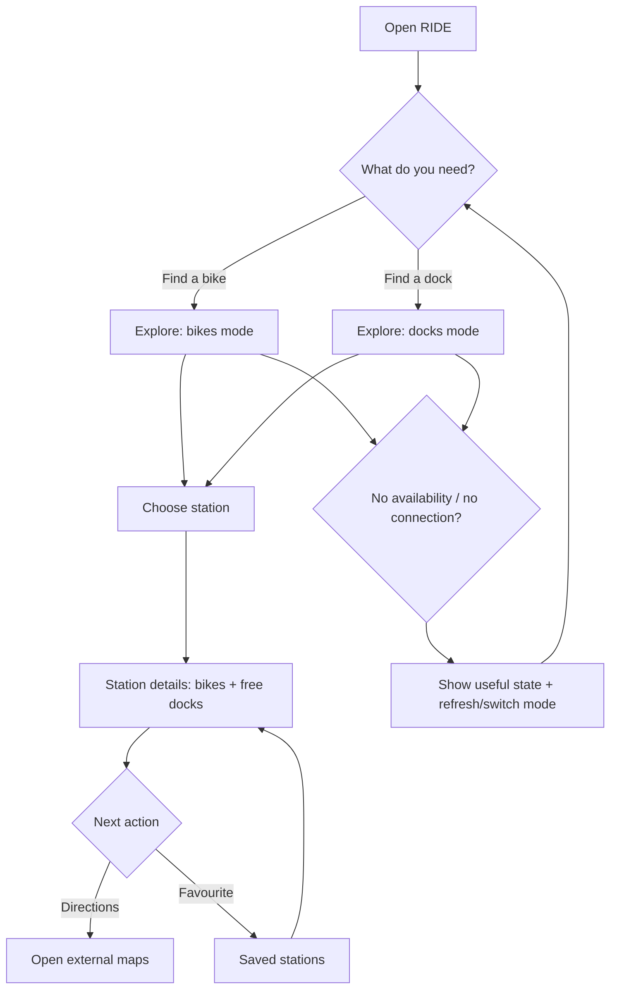

# RIDE — Userflow

## Phase 5 tab navigation and mobile polish

Signed-in app → persistent Explore / Saved / Account tabs. Explore retains Map/List, mode/search/filter, camera and selection state when changing tabs. Details open inside Explore or Saved and return to the originating tab; bottom tabs remain visible. Login, signup and callback screens remain outside the protected tab shell.

Station name → bookmark (outlined = not saved, filled = saved) → pending indicator → confirmed state. Failures keep the previous confirmed state and expose an accessible error/retry action. Preview and detail share the same user-scoped favourites store.

Map pin → RIDE preview only; cluster → zoom or member list → preview. Small status indicator → data panel → refresh/retry, fetch age and CityBikes attribution. Stale or failed data never receives a fresh/green state. Screen content and preview scroll within their bounds above the bottom safe area; list search avoids the keyboard.

## Phase 4.3 Saved stations

Sign in → fresh account-scoped Saved load → Explore. Station detail or selected map preview → Save station → wait for server acknowledgement → Saved state everywhere. Tap Unsave → successful delete → remove from Saved. Failed/offline writes keep the last confirmed state and offer retry; there is no background write queue.

Explore → Saved → current user's saved IDs joined with the shared CityBikes cache → station detail. Pull-to-refresh reloads both Saved IDs and station counts (respecting CityBikes cooldown). Missing station records remain removable with unavailable-count guidance. Empty Saved offers Explore; first-load failure offers retry; failed refresh retains only this user's previously loaded IDs with a stale/offline message.

Sign out/account switch → discard private in-memory Saved state before rendering another account → fresh load for the new user. Slow old-account requests cannot populate the new account. After a cold offline launch, show an error/retry rather than inventing an empty Saved list. Supabase persists favourites across online restarts; the phone keeps no disk copy in this phase.

Earlier local-only favourites plans are superseded by this explicitly authorized phase. Existing authentication, map, Bike/Dock, search, details and directions remain unchanged.

## Phase 4.2 redirects and Google

Development/production build: Sign Up → confirmation email → Supabase verifies email → `rideapp://auth/callback` → exchange the one-use PKCE code using this installation's secure verifier → existing session listener → Explore. Cold and warm app callbacks share processing. Invalid/expired/already-used links show recovery; an already confirmed user can log in with email/password. Confirmation on another device may verify the email but cannot exchange this installation's verifier.

Expo Go: Sign Up → owned HTTPS confirmation landing page → manually return to RIDE → Log In. Google button explains that a development build is required. No temporary Expo Go address is used for authentication.

Log In / Sign Up → Continue with Google → system authentication browser → Google → Supabase HTTPS callback → RIDE scheme callback → PKCE exchange → Explore. Cancel stays signed out with a neutral message; provider/network failures offer another attempt or email login. Starting a newer signup/OAuth flow replaces the previous PKCE verifier; use the latest link.

The Phase 4.1 flow below is historical; Phase 4.2 supersedes its no-OAuth/no-callback scope. Approved moodboard and all bike/dock flows remain unchanged.

## Phase 4.1 entry and authentication
Launch → branded session restoration → signed in: Explore; signed out: Log In. Protected Explore, station and Account links cannot bypass restoration or login.

Log In ↔ Sign Up → submit email/password once → if confirmation is required, show neutral email guidance → open the email confirmation link in the browser → return to RIDE and log in. No password or email is placed in route parameters. If confirmation is disabled in Supabase, a returned session opens Explore directly.

Explore → tap RIDE account shortcut → Account → sign out on this device → Log In, with protected history removed. Failed sign out shows a retryable error. Backgrounding stops automatic token refresh; foregrounding resumes it. Restoration failures block protected screens and offer retry.

The original bike/dock flows below remain available after authentication. This explicit Phase 4.1 scope supersedes the earlier no-auth plan; no favourites database or OAuth is added.

Both map and list should offer access to every station's individual detail page. Data can update, so always show last updated timestamp.

## Phase 2 foundation

Open RIDE → load the Velo Antwerpen station list → select a station → `station/[id]` with real counts, location and source update time → back to the list.

First-load failure → retry. Empty response → explain and refresh. Pull-to-refresh → retain existing cards while loading; on failure, label the retained results as cached. A direct detail link loads the shared network data if necessary; an unknown ID shows a station-not-found message and a way back to the list. No location permission is needed.

## Phase 3 Explore flow

Open Explore → choose Find a bike or Find a dock → search by station name / filter availability → Map or List.

- Map → tap a real station pin → selected-station preview → details or external directions.
- List → browse stations ranked by the selected count → select station → existing detail route → external directions.
- Changing modes updates sorting, availability filters, primary counts and marker labels/colours. Unknown is never treated as zero; closed stations never count as available.
- Search/filter changes keep a selected station only if it still belongs to the results. Clear filters to restore all stations. Missing coordinates remain accessible in List.
- Map unavailable or offline tiles → switch to List; cached station data and retry behaviour remain usable.
- Directions hand the real destination to Google Maps (app or browser); the external app handles the starting point. RIDE never requests or assumes the user's position.

### Phase 3.1 mobile correction
- Map opens with a compact fixed RIDE header and mode selector. List contains name search and filters; the selected mode/query/filter survives switching back to Map.
- Tap a cluster to zoom into its real stations. At very close/identical coordinates, choose a named member instead of repeatedly zooming without a usable selection.
- Tap a station for the compact bottom overlay; close it to restore the full map. Data/refresh and CityBikes attribution are available through the map's Data button; errors/cached status remain visible on that button.
- List scrolls solely through FlatList; there is no scrolling header above the native map. No development overlay is removed or hidden.

### Phase 3.2 mobile polish
- The compact Map / List switch retains the same search/filter state; open List to search. Find a bike / Find a dock remains visible above the flex map.
- Count-only cluster badges retain the same zoom/member chooser actions. VoiceOver still announces the station count and action; selected stations remain separate native pins.
- Open details → read the selected station's live bike/dock counts → Get Directions. Address and source update time remain visible; expand Technical information only to inspect coordinates. Refresh, cached/error messages and CityBikes credit remain available below.

### Phase 5 status and validation notes — 2026-11-26

A recent fetch alone does not guarantee fresh source data. The small indicator uses fresh lime only when fetch and all known station source times meet freshness thresholds; old/unknown timestamps are amber/neutral. Connection failures say “Connection issue” and mark retained results cached; the app does not infer airplane mode. Refresh/retry remains available in the chip's data panel and compact list/detail controls.

97 automated tests, TypeScript, dependency and both native bundle checks pass. Phone acceptance is pending; use [PHASE5_REVIEW.md](docs/PHASE5_REVIEW.md). Earlier account shortcuts/large Save buttons are superseded by the tab/bookmark flow above.
