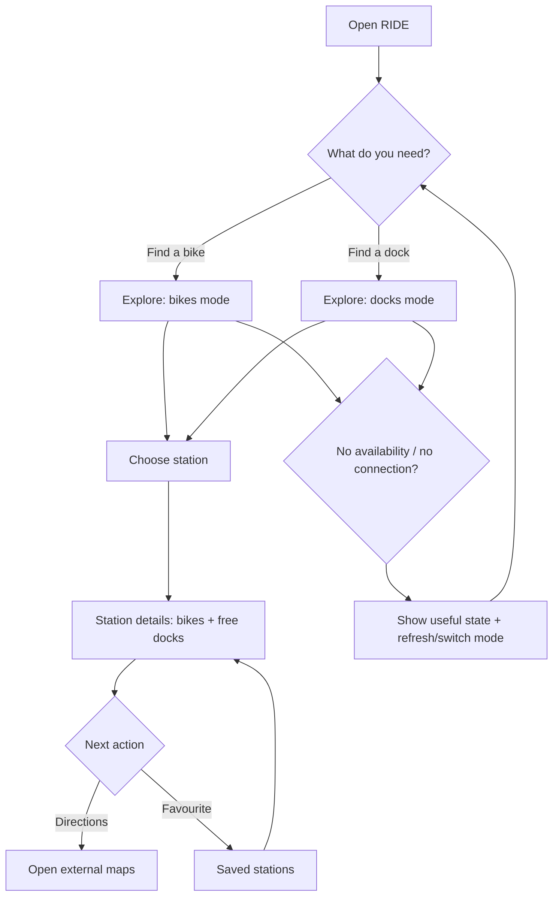

# RIDE — Userflow

Both map and list should offer access to every station's individual detail page. Data can update, so always show last updated timestamp.

## Phase 2 foundation

Open RIDE → load the Velo Antwerpen station list → select a station → `station/[id]` with real counts, location and source update time → back to the list.

First-load failure → retry. Empty response → explain and refresh. Pull-to-refresh → retain existing cards while loading; on failure, label the retained results as cached. A direct detail link loads the shared network data if necessary; an unknown ID shows a station-not-found message and a way back to the list. No location permission is needed.

## Phase 3 Explore flow

Open Explore → choose Find a bike or Find a dock → search by station name / filter availability → Map or List.

- Map → tap a real station pin → selected-station preview → details or external directions.
- List → browse stations ranked by the selected count → select station → existing detail route → external directions.
- Changing modes updates sorting, availability filters, primary counts and marker labels/colours. Unknown is never treated as zero; closed stations never count as available.
- Search/filter changes keep a selected station only if it still belongs to the results. Clear filters to restore all stations. Missing coordinates remain accessible in List.
- Map unavailable or offline tiles → switch to List; cached station data and retry behaviour remain usable.
- Directions hand the real destination to Google Maps (app or browser); the external app handles the starting point. RIDE never requests or assumes the user's position.

### Phase 3.1 mobile correction
- Map opens with a compact fixed RIDE header and mode selector. List contains name search and filters; the selected mode/query/filter survives switching back to Map.
- Tap a cluster to zoom into its real stations. At very close/identical coordinates, choose a named member instead of repeatedly zooming without a usable selection.
- Tap a station for the compact bottom overlay; close it to restore the full map. Data/refresh and CityBikes attribution are available through the map's Data button; errors/cached status remain visible on that button.
- List scrolls solely through FlatList; there is no scrolling header above the native map. No development overlay is removed or hidden.
